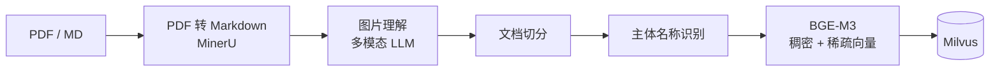
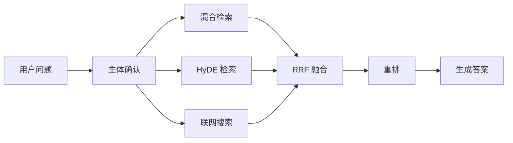

# 格物致知 · Gewu

> **格物致知**，语出《礼记·大学》。把一台设备的说明书「格」到底，自然就懂了它。

面向**设备手册**的 RAG 知识库问答系统：把 H3C 路由器、华为擎云笔记本、打印机、烫金机这类
产品手册（PDF / Markdown）自动消化成向量知识库，再用对话的方式把答案连图一起问出来。

---

## 它能做什么

- **手册自动入库**：PDF → Markdown → 图片理解 → 切分 → 主体识别 → 双向量 → Milvus，全流程自动化
- **图片看得懂**：手册里的接线图、面板图、步骤截图交给多模态模型转成文字描述，答案里再把原图带出来
- **检索不止一路**：稠密 + 稀疏混合检索、HyDE 假设性文档检索、以及联网搜索兜底，最后 RRF 融合 + 重排
- **进度看得见**：用 SSE 把每个 LangGraph 节点的执行状态实时推给前端，不再是干等
- **一条命令起依赖**：Milvus / etcd / MinIO / Attu / MongoDB 全部收进一份 `docker-compose.yml`

---

## 架构

### 导入链路



对应 `app/import_process/agent/main_graph.py` 的节点：
`node_entry → node_pdf_to_md → node_md_img → node_document_split → node_item_name_recognition → node_bge_embedding → node_import_milvus`
（`.md` 输入会跳过 PDF 转换，少一步。）

### 检索链路



对应 `app/query_process/agent/main_graph.py`，其中「主体确认」如果判断用户没问清是哪个产品，
会直接走答案节点反问，不进入检索。

---

## 技术栈

| 层 | 选型 |
| --- | --- |
| 编排 | LangGraph（状态图 + 条件边 + 多分支并行） |
| 服务 | FastAPI + Uvicorn（导入服务、查询服务各一个进程） |
| 向量库 | Milvus 2.6（HNSW 稠密索引 + SPARSE_INVERTED_INDEX 稀疏索引） |
| Embedding | BGE-M3（稠密 + 稀疏一次生成） |
| 重排 | BGE-Reranker-Large |
| 大模型 | 阿里云百炼 DashScope（OpenAI 兼容接口，可换任意兼容服务） |
| PDF 解析 | MinerU API |
| 对象存储 | MinIO |
| 对话历史 | MongoDB |
| 基础设施 | Docker Compose |

---

## 目录结构

```
.
├── app/
│   ├── config/                 # 配置层（env.py 统一加载 .env，各配置对象从这里取值）
│   ├── core/                   # 日志、提示词加载
│   ├── clients/                # Milvus / MongoDB / MinIO 客户端封装
│   ├── lm/                     # 大模型、Embedding、Reranker 客户端
│   ├── utils/                  # task_utils（进度）、sse_utils（SSE 队列）、转义等
│   ├── import_process/         # 导入服务：LangGraph 节点 + FastAPI + 前端页面
│   └── query_process/          # 查询服务：LangGraph 节点 + FastAPI + 对话/监控页面
├── prompts/                    # 提示词模板
├── docker/                     # Docker 说明与数据迁移脚本
├── test/                       # 两个跑通全流程的脚本
├── docker-compose.yml          # 基础设施一键启动
├── docker-start.bat / docker-stop.bat
├── pyproject.toml / uv.lock
└── .env.example                # 环境变量模板（复制成 .env 使用）
```

---

## 快速开始

### 1. 环境要求

- Python **3.11+**
- Docker Desktop（Compose v2）
- 两张 Key：**百炼 API Key**（大模型 + 多模态）和 **MinerU Token**（PDF 解析）

### 2. 安装依赖

```bash
uv sync      # 按 uv.lock 安装，推荐
```

> 本项目**不是可安装包**（`pyproject.toml` 没有 build-system，`uv.lock` 里是 `virtual = "."`），
> 所以不需要 `pip install -e .`。依赖装进当前 Python 环境即可，服务和脚本都从**仓库根目录**运行，
> `uvicorn app.xxx:app` 会以当前目录作为导入根。

模型（BGE-M3 / BGE-Reranker）可以提前下到本地，避免首次运行现拉：

```bash
python app/tool/download_bgem3.py
python app/tool/download_reranker.py
```

### 3. 配置

```bash
copy .env.example .env      # Windows
cp   .env.example .env      # macOS / Linux
```

至少填两项：`OPENAI_API_KEY`、`MINERU_API_TOKEN`。其余默认值对应下面 compose 起的服务端口，可直接用。

### 4. 启动基础设施

```bash
docker compose up -d
```

Windows 上也可以直接双击 `docker-start.bat`。首次启动 Milvus 要等 1–2 分钟，`docker compose ps`
里 `milvus-standalone` 显示 `healthy` 才算就绪。

| 服务 | 地址 |
| --- | --- |
| Milvus | `127.0.0.1:19530`（健康检查 `:9091/healthz`） |
| MinIO 控制台 | http://127.0.0.1:9003（数据口 `9002`，默认 `minioadmin / minioadmin`） |
| Attu（Milvus 可视化） | http://127.0.0.1:3000 |
| MongoDB | `127.0.0.1:27017` |

### 5. 启动两个服务

```bash
# 导入服务
uvicorn app.import_process.api.file_import_service:app --host 0.0.0.0 --port 8000 --reload

# 查询服务
uvicorn app.query_process.api.query_server:app --host 0.0.0.0 --port 8001 --reload
```

### 6. 打开页面

| 页面 | 地址 | 说明 |
| --- | --- | --- |
| 文件导入 | http://127.0.0.1:8000/import.html | 上传 PDF/MD，按 8 个（PDF）/ 7 个（MD）步骤显示真实进度 |
| 对话查询 | http://127.0.0.1:8001/chat.html | 提问，实时看阶段进度，答案带图 |
| 查询监控 | http://127.0.0.1:8001/query_monitor.html | 最近查询、成功率、P95 延迟、单个会话详情 |

---

## 接口

### 导入服务（:8000）

| 方法 | 路径 | 说明 |
| --- | --- | --- |
| GET | `/import.html` | 导入页面 |
| POST | `/upload` | 上传文件（multipart，字段名 `files`），返回 `task_ids` |
| GET | `/status/{task_id}` | 任务进度：`status` + `done_list` + `running_list` |

### 查询服务（:8001）

| 方法 | 路径 | 说明 |
| --- | --- | --- |
| GET | `/health` | 健康检查 |
| GET | `/chat.html` | 对话页面 |
| GET | `/query_monitor.html` | 监控页面 |
| POST | `/query` | 发起提问 `{query, session_id, is_stream}` |
| GET | `/stream/{session_id}` | SSE 流，事件：`ready` / `progress` / `delta` / `final` / `error` |
| GET | `/history/{session_id}` | 查询历史对话 |
| DELETE | `/history/{session_id}` | 清空历史对话 |
| GET | `/query/monitor/recent` | 最近查询列表 + 汇总指标 |
| GET | `/query/monitor/{session_id}` | 单个会话详情 |

---

## 数据落在哪

| 数据 | 位置 |
| --- | --- |
| 切片向量 | Milvus 集合 `kb_chunks`（字段含 `item_name`、`file_title`、稠密/稀疏向量） |
| 主体名向量 | Milvus 集合 `kb_item_names` |
| 对话历史 | MongoDB `kb002.chat_message` |
| 手册图片 | MinIO 桶 `knowledge-base-files`，目录 `/upload-images` |
| 中间产物 | 本地 `output/YYYYMMDD/<task_id>/`，日志在 `logs/` |

> 幂等说明：重复导入同一份文档时，按 **`item_name` + `file_title`** 精确清理旧切片。
> 只按 `item_name` 删会把同主体的其它手册一起删掉（例如两本手册都识别成「华为手机」），所以这里加了 `file_title` 限定。

---

## 已知限制

- **进度与监控都是进程内内存**：uvicorn 重启即清空，且只在单进程内有效；要横向扩展得换成 Redis 之类的共享存储。
- **进度按 `session_id` 存**：每个会话只保留最近一轮，同一会话并发提问会互相覆盖。
- **Embedding / Reranker 默认跑 CPU**：向量化比较慢，有 GPU 就把 `BGE_DEVICE` / `BGE_RERANKER_DEVICE` 改成 `cuda:0`。
- **示例语料未随仓库分发**：`doc/` 下的设备手册（400MB+）属于第三方文档，未提交。
- **没有正式的单测**：`test/` 下是两个「跑通全流程」的脚本，没有断言，不能当回归测试用。

---

## 说明

- `.env` 里有真实密钥，已在 `.gitignore` 中排除，**不要提交**。
- `docker-start.bat` / `docker-stop.bat` 使用 CRLF + 纯 ASCII，`.gitattributes` 已固定为 `-text`，避免换行被改写。
- 仓库暂未选择开源许可证（默认保留所有权利）。如需开源，请自行补充 `LICENSE`。
